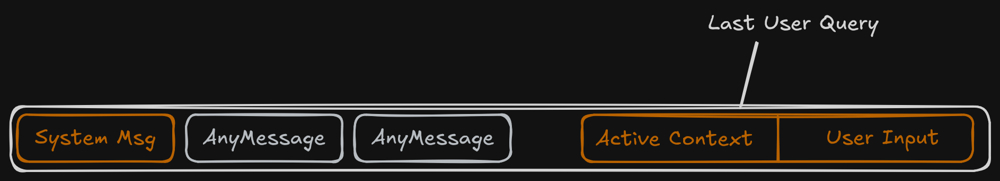

# Agentic Awareness

### Data types by usage

First of all let's split all data we operate with into:
- What we send to the LLM 
- What we store in the history

The history should present data useful for LLM operator, 
the LLM request should contain data useful for LLM itself.
Of course in some situations those data stores overlaps (usually within agent loop,
where LLM store tool data within a message history).

Context splits into saved and ephemeral ( only sends to the LLM )
Chat history is a temporary volatile data, usually it's corrupted by summarizing or sliding window.


### Data Types by priority
We have three types of data present in our context.

- Constant Context: AGENTS.md - constant agent instructions
- Active Context: do not appear in actual history, appends to LLM request ( changes in EACH new request)
- Chat Messages - Any messages appears in chat, affected by data corruption.

> In the best case ToolCall message should disappear from chat history right after usage by agent.
Example in VEX: [get_safe_window](./src/vex_shell/engine/helpers.py#L49)

Constant data (attached for each message to the LLM usually gathered from AGENTS.md)
[Request payload constructing](./src/vex_shell/engine/nodes.py#L78)


### Active Context 
Active Context is *ephemeral data attached to LLM request*, that's *never* presents in 
chat history. Obviously, the reason is that this data changes frequently ( maybe of EACH new LLM request).
The simplest example is follow loop

```
1. LLM writes data in file 
2. Code validator throws error about written data  
3. LLM should create NEW read request to understand where error occured.
```


*VEX ephemeral Context Schema*

[Active Context Tool Example](./src/vex_shell/tools/tools.py#L61)
Above implementation of _read_files function used by read_files tool, 
the tool itself does one important job, it writes data in agent state instead of chat history

And later inside [ActiveContext constructing](./src/vex_shell/engine/helpers.py#L75)
we can see how entire ActiveContext constructed.

Of course the implementation could be more sophisticated, and use generic ToolStore 
instead of hardcoded tool names, but concept is clear. 

P.S. I thinking for a while about tool count which actually could be used with Active Context 
and I think it's not a huge amount, that depends heavily on agent's domain.

### Some tweaks with write
Here's some tweaks that helps model to operate better with writing workload

- The first is [Auto CWD tree](./src/vex_shell/utils/fs.py#L10) - it's simple utils that calls 
tree_tool for current working directory and injects it into ActiveContext

- The second is [cache_on_write](./src/vex_shell/tools/tools.py#L133) - even more simple tweak
that automatically appends written file to ActiveContext File cache.

### Summary
I don't think that it's the best possible architecture of course but my goal was 
decrease the number of wasted LLM requests and at same time make agent more deterministic tool. 
So likely I reached some goals.


