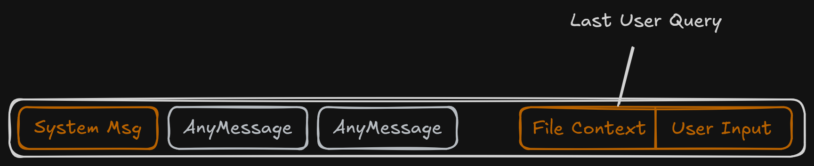

# File Context Management 

VEX Shell use deterministic file context management system, in a nutshell I can 
describe it as "Mark once, hot-reload forever". 

**How it works ?**

When user ask agent for file content, like "What does func test() from ./main.py ?"
agent request `cat_tool` for this file, `cat_tool` read file, store in file_context and in future before each user request file content will be updates in history if file was changed (It checked by file modification time info provided by OS).

As result LLM always gets the last version of tracked files and gives more attention to file context than to messages in chat.

## References
1. [cat_tool](../src/utils/tools.py)
1. [file context update](../src/utils/fs.py)