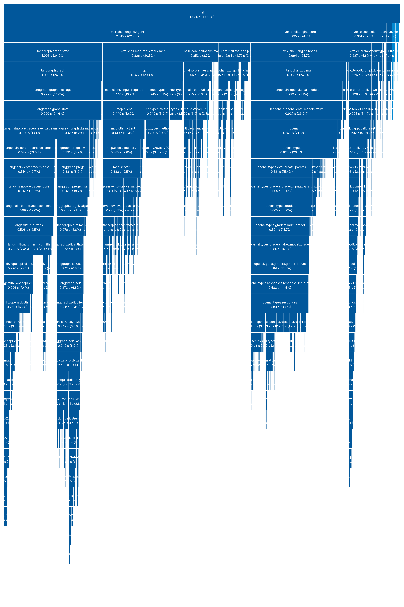
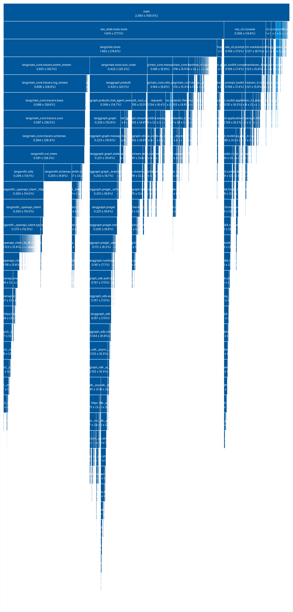

# Architecture Deep Dive: Startup Time & Import Optimization

Here's where I started about 4s of cold start for both utility functions and main vex program - just disgusting speed for a *cutting-edge* agentic runtime.

## The difference between main app and utility functions 
All *utility* functions are a shortcuts that usually avoid main program functionality, for example 
- `--help` - just show help message
- `--ls` - list session, touch only sqlite database

Obviously such functions should work almost immediately.
How to speed up *utility* functionality in this case ? 
Just bypass main program initialization:

```py
# Main CLI start point
async def run_agent(args):
    # ...

    # Short circuits for utility functions 
    if args.init:
        init_workspace(console=console)
        return
    if args.list_sessions:
        await list_sessions(settings,console)
        return

    # Start agent, heavy lift imports
    from vex_shell.engine import core
    from vex_shell.engine.agent import Agent

    tools,mcp_manager = await core.get_tools(settings)
    graph = core.build_graph(settings, tools)
    agent = await Agent.create(graph, args.session, settings, mcp_manager)
```
*[cli.py](../src/vex_cli/cli.py#43)*

All heavy imports occur after utility args checking(`from vex_shell.engine import core` etc).

## Main App Startup Optimization

Okay let's consider that we have blazingly fast utility functions, but what about main app startup ?
Using some extremely useful tools, like  *[tuna](https://pypi.org/project/tuna/)* and `-X importtime`. I have investigated which modules slow down startup. Tuna generated visual map  showing the exact time required for module imports.

Based on this map, I found several bottlenecks in the codebase.

### Type Annotation-Only Imports
During development, module-level imports are often added purely for type
annotations:
```py
from vex_shell.utils.config import Settings
```
Even if `Settings` is used for type hints only, the **entire** `config` module, will still be loaded.
To prevent this unexpected behavior, we can use the following pattern:

```py
from __future__ import annotations
from typing import TYPE_CHECKING

if TYPE_CHECKING:
    from vex_shell.engine.agent import Agent
    from rich.console import Console
    from vex_shell.utils.config import Settings
```

`TYPE_CHECKING` evaluates to `False` during runtime, ensuring these imports are used strictly for static type checking during development. This yields **zero** resource overhead during execution.

### Function-Scoped Imports

Usually we just import most of modules at the top of `.py` file, but in this case we transfer all imports to application start time. Which isn't always a good choice. Alternatively we can use `on-demand imports`, thus import module during function call. Of course it will slow down function call time, but we can achieve shorter start time, moving delays to runtime, and it's also worth noting that any imports loaded only on the first call, after modules are already in cache.

```py
def build_graph(settings: Settings, tools:List[BaseTool]) -> StateGraph:
    # On demand importing for heavy modules, only when function CALLED
    from langgraph.graph.state import  StateGraph
    from langgraph.prebuilt import ToolNode

    from .nodes import llm_call_node, verification_node, should_continue, should_verify
    from .state import State

    tool_names = [e.name for e in tools]
    
    graph = StateGraph(State)
    
    # LLM Nodes
    graph.add_node(
        "llm_call", partial(llm_call_node, settings=settings, tool_names=tool_names)
    )
    graph.add_node("tool_node", ToolNode(tools))
    graph.add_node("verification_node", partial(verification_node, settings=settings))
    # ...
```

### Fun to note

In [nodes.py](../src/vex_shell/engine/nodes.py) I used `from langgraph.graph.state import END`
only for `END` constant, but it leads to a whole module import which consumes `1.36s`. By  just replacing this import with `END = "__end__"` I saved this time.


## Approximate results

1. MCPManager - imported only if defined in CONFIG.toml, saves 1 second.
2. Move all annotation-only imports into a `TYPE_CHECKING` guard.
3. Move all heavy imports inside functions (`ChatOpenAI`,`langchain.messages`,etc)

## Timings

- Utility functions - `-ls/--help/--reset` ~400ms
- Main app start time (without MCP tools) ~2.1 seconds
- Main app start time (with MCP tools)    ~2.7 seconds

<details> 
    <summary>Tuna diagrams here</summary>
    
    
</details>

<br>

> Thanks for reading, Bye ₍^. .^₎⟆